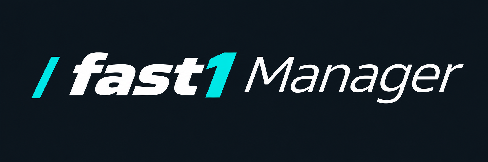

# fast1 Manager



**Ein Formel-Rennmanager für den Browser.** Entwickle dein Auto, führe dein Team durch mehrere Saisons und sieh im 3D-Rennen, wie sich deine Entscheidungen auf die Rundenzeiten auswirken.

**Projektstatus** · Ein klickbarer UI-PoC mit fünf Ansichten ist verfügbar. Am Rennstand werden feste Beispieldaten angezeigt.

## Demo lokal starten

Voraussetzung ist Node.js ab Version 22.12 innerhalb der 22er-Reihe oder eine neuere von Vite unterstützte Version.

```sh
npm ci
npm run dev
```

Öffne die URL, die Vite im Terminal anzeigt. Starte die Demo, übernimm ein Team und wähle in der Fahrzeugentwicklung einen Unterboden. Am Rennstand siehst du dein Team, beide Fahrer und das gewählte Setup. Die Auswahl bleibt beim Seitenwechsel in der laufenden Demo erhalten.

Mit `npm run build` prüfst du die TypeScript-Typen und erstellst den Produktionsbuild in `dist/`.

## Eine Saison als Teamchef

| Zeitpunkt | Deine Entscheidungen |
| --- | --- |
| Vor der Saison | Fahrer verpflichten, das Reglement auswerten und das Entwicklungsbudget auf technische Konzepte verteilen. |
| Zwischen den Rennen | Messdaten auswerten, Prototypen testen und entscheiden, welche Teile ans Auto kommen. |
| Am Kommandostand | Beide Fahrer im Live-Timing verfolgen, Tempo vorgeben, Reifen schonen und Boxenstopps planen. |
| Vor dem Saisonwechsel | Abwägen, ob sich ein letztes Upgrade lohnt oder Personal und Budget bereits ins Folgeauto fließen. |

Die Konkurrenz entwickelt ebenfalls weiter. Selbst wenn dein Auto schneller wird, kannst du im Feld zurückfallen, wenn andere Teams größere Fortschritte machen.

## Forschung, Risiko und Reglement

Ein neuer Unterboden verspricht mehr Abtrieb in schnellen Kurven. Deine Ingenieure können den möglichen Zeitgewinn zunächst nur als Bandbreite angeben. Du entscheidest, ob du einen weiteren Test bezahlst, das Teil direkt fertigen lässt oder das Projekt beendest. Auf glattem Asphalt könnte der Unterboden Zeit gutmachen, auf Bodenwellen dagegen empfindlich auf Änderungen der Fahrzeughöhe reagieren.

Tests liefern Messwerte, aus denen dein Team die tatsächlichen Eigenschaften eines Konzepts besser abschätzen kann. Ein teures Projekt kann enttäuschen, während ein früher Fund mehrere Saisons prägt. Jede Saison hat ein eigenes Regelwerk, etwa mit Grenzen für Bauteilabmessungen und Testzeit. Wird ein Teil durch einen Regelwechsel unzulässig, kann dein Team die gewonnenen Erkenntnisse beim Entwurf des Nachfolgers weiter nutzen.

## Rennsimulation und 3D-Ansicht

Die geplante Simulation berechnet das Rennen in festen Zeitschritten. Fahrzeug, Fahrer, Reifen und Verkehr bestimmen das Tempo auf jedem Streckenabschnitt. Mehr Abtrieb kann in einer schnellen Kurve helfen, während zusätzlicher Luftwiderstand den Vorteil auf der nächsten Geraden wieder aufzehrt.

Erhöhte Streckenkameras und erkennbare Teamfarben machen das Feld in der 3D-Ansicht übersichtlich. Strecke, Minimap und Live-Timing greifen auf denselben Rennzustand zu. Der Zeitraffer führt mehr Simulationsschritte pro Sekunde aus. Bei identischem Startzustand, Zufallsstartwert und identischen Befehlen zu denselben Simulationszeitpunkten bleibt das Ergebnis reproduzierbar.

## Erster spielbarer Meilenstein

Der Prototyp ist als lokales Einzelspiel geplant. Auf einer fiktiven Strecke fahren acht Autos fünf Runden. Du wählst vor dem Start eine von zwei Unterbodenvarianten für dein Team und verfolgst das Rennen aus einer erhöhten 3D-Kamera.

- Die Varianten erzielen unter gleichen Bedingungen messbar unterschiedliche Sektorzeiten.
- Die Positionen und Abstände stimmen auf der Strecke, auf der Minimap und im Live-Timing überein.
- Das Rennen liefert bei 1× und 4× mit denselben Eingaben dieselben Rundenzeiten und dieselbe Zielreihenfolge.

## Geplanter Tech-Stack

| Bereich | Technologie | Aufgabe |
| --- | --- | --- |
| Browser-App | React, TypeScript, Vite | Teamverwaltung, Entwicklung, Live-Timing und Rennsteuerung |
| 3D-Darstellung | Three.js, React Three Fiber | Strecke, Fahrzeuge, Kameras und flüssige Darstellung zwischen Simulationsschritten |
| Spielkern | Eigenständige TypeScript-Module | Rennen, Bauteile, Forschung, Finanzen und Reglement |
| Spielstände | IndexedDB | Karriere, Entwicklungsprojekte und Zufallszustand lokal speichern |
| Tests | Vitest, Playwright | Spielregeln, reproduzierbare Rennläufe und zentrale Spielabläufe im Browser prüfen |

Der Spielkern soll unabhängig von der Browseroberfläche laufen. So lassen sich Rennen automatisiert durchspielen und Fahrzeugkonzepte unter identischen Bedingungen vergleichen.

## Weitere Entwicklung

1. **Rennstrategie** mit Überholmanövern, Reifenverschleiß, Boxenstopps und getrennten Anweisungen für beide Fahrer.
2. **Konstrukteursbetrieb** mit Budget, Entwicklungszeit, Prognosen und Tests. KI-Teams investieren unter denselben Regeln.
3. **Karriere** mit Fahrermarkt, Verträgen, Meisterschaft und lokalen Spielständen.
4. **Saisonwechsel** mit angekündigten Regeländerungen, paralleler Entwicklung des Folgeautos und der Übernahme von Forschungserkenntnissen.

## Entwicklung mit Spezifikationen

Größere Features erhalten Markdown-Spezifikationen mit Spielregeln, technischer Umsetzung und prüfbaren Akzeptanzkriterien. Kiro und Codex können dabei mit denselben Dateien im Repository arbeiten. Für die Rennsimulation dient der Vergleich bei 1× und 4× als erster Akzeptanztest.
